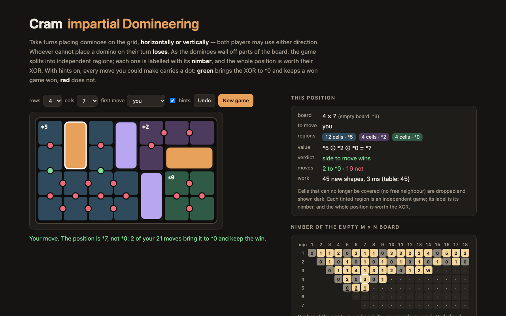

# Cram — dominoes either way, a perfect player, and every region's nimber



**Cram** is Domineering with the colours taken away. Two players take turns placing dominoes on a grid, and **both
may place them horizontally or vertically**. Whoever cannot place a domino on their turn loses.

Because both players have the same moves, Cram is an *impartial* game, and the Sprague–Grundy theorem applies: every
position is worth exactly one Nim heap, its **nimber**. And because a Cram board falls apart into independent regions
as the dominoes wall them off, the whole position is worth the XOR of its regions' nimbers.

This page lets you play it against a perfect player on any board up to 28 cells (1 × 2 to 6 × 4, 4 × 7, 2 × 10…),
moving first or second. Each region of free cells is tinted and labelled with its nimber; the side panel shows the
XOR, and with hints on, every move you could make carries a dot: **green** brings the XOR to *0 and keeps a won game
won, **red** does not. A chart shows the nimber of every empty m × n board computed here, checked against the tables
of Lemoine and Viennot, *Nimbers are inevitable* (2010).

TypeScript, no runtime dependencies. The solver runs in a Web Worker on the page and under Node for the chart.

## The solver

[`src/cram.ts`](src/cram.ts):

- **Regions.** The free cells are kept as one bitmask per row. After a move they are flood-filled into connected
  regions, each cut down to its own bounding box. A cell with no free neighbour can never be covered and is dropped
  right away, so a region always has at least two cells.
- **Shapes, not positions.** The table maps a region's *shape* to its nimber. The key is the smallest row list among
  the region's eight symmetric copies (only the orientations with no more rows than columns are compared). So a
  five-cell L in a corner of a 3 × 9 board is the same entry as a mirrored L in the middle of a 5 × 5.
- **Nimber of a region** = mex of the values of its options; the value of an option = XOR of the nimbers of the
  regions it leaves. Regions of 2 or 3 cells are *1 without a lookup (any move leaves at most one cell).

`Cram` runs the full mex. Two more searches are there for the comparison below:

- `PlainSearch` decides who wins without nimbers: a position (a multiset of region shapes) is won if some move leads
  to a lost position. Its table is keyed by the whole sum, so every combination of regions is a new entry.
- `CoupleSearch` is Lemoine and Viennot's method. "Is the nimber of *P* equal to *n*?" is the same question as "does
  the player to move lose *P* + \**n*?", and that is a win/loss search that stops at the first winning reply. In a sum,
  every region whose nimber is already known is folded into the heap; if two or more unknown regions remain, the
  smaller ones get their nimbers computed (trying *n* = 0, 1, 2, … until a losing couple turns up), and only the
  largest is searched as a couple. It stores couples (shape, *n*) → win/lose.

## The symmetry strategy

On an **even × even** board the second player wins by answering every move with its mirror image through the
centre: a domino's centre is the midpoint of an edge, the board's centre is a lattice point, so no domino is its own
mirror image and the reply is always free. On an **even × odd** board the first player covers the two central cells
and then plays the same strategy as second player. So even × even boards are *0 and even × odd boards are not — the
tests check both on everything computed. Odd × odd boards have no such argument; they are where the computing is.

## Results

Computed under Node 26 on a 12-core Mac mini. Each family of boards ran in one process with a shared table and a
45–50 minute wall-clock limit; "W" means only the win/loss search finished (first player wins), "—" means the run hit
its limit. Every board computed here that is in Lemoine and Viennot's tables agrees with them.

### 3 × n

| n | here | paper |
|---|---|---|
| 3 | *0 | *0 |
| 4 | *1 | *1 |
| 5 | *1 | *1 |
| 6 | *4 | *4 |
| 7 | *1 | *1 |
| 8 | *3 | *3 |
| 9 | *1 | *1 |
| 10 | *2 | *2 |
| 11 | *0 | *0 |
| 12 | *1 | *1 |
| 13 | *2 | *2 |
| 14 | W | *3 |
| 15 | — | *1 |
| 16 | — | *4 |
| 17 | — | *0 |
| 18 | — | *1 |

### m × n, m ≥ 4

| board | here | paper |
|---|---|---|
| 4 × 4 | *0 | *0 |
| 4 × 5 | *2 | *2 |
| 4 × 6 | *0 | *0 |
| 4 × 7 | *3 | *3 |
| 4 × 8 | *0 | *0 |
| 4 × 9 | *1 | *1 |
| 5 × 5 | *0 | *0 |
| 5 × 6 | *2 | *2 |
| 5 × 7 | *1 | *1 |
| 5 × 8 | — | *1 |
| 5 × 9 | — | W |
| 6 × 6 | — | *0 |
| 6 × 7 | — | >3 |
| 6 × 8 | — | *0 |
| 6 × 9 | — | W |
| 7 × 7 | — | W |
| 7 × 8 | — | W |

### 2 × n

n = 1..24: 1 0 1 0 1 0 1 0 1 0 1 0 1 0 1 0 1 0 1 0 1 0 1 0

### three methods, fresh table per board (entries solved)

| board | nimber | full mex | no nimbers (whole sums) | couple search (win/loss) |
|---|---|---|---|---|
| 2 × 4 | *0 | 7 | 11 | 7 |
| 3 × 3 | *0 | 9 | 8 | 5 |
| 2 × 6 | *0 | 29 | 42 | 30 |
| 3 × 4 | *1 | 52 | 33 | 25 |
| 4 × 4 | *0 | 194 | 132 | 106 |
| 3 × 5 | *1 | 211 | 115 | 99 |
| 3 × 6 | *4 | 778 | 456 | 358 |
| 4 × 5 | *2 | 2,300 | 1,607 | 1,236 |
| 3 × 7 | *1 | 2,760 | 2,574 | 1,801 |
| 4 × 6 | *0 | 16,234 | 12,857 | 9,001 |
| 5 × 5 | *0 | 16,453 | 12,552 | 8,383 |
| 3 × 8 | *3 | 9,680 | 7,152 | 4,114 |
| 3 × 9 | *1 | 33,922 | 39,565 | 20,943 |
| 4 × 7 | *3 | 109,821 | 95,939 | 61,090 |
| 3 × 10 | *2 | 118,990 | 142,446 | 62,318 |
| 5 × 6 | *2 | 356,379 | 242,681 | 146,066 |
| 3 × 11 | *0 | 417,635 | 850,837 | 312,182 |
| 4 × 8 | *0 | 715,765 | 920,582 | 481,201 |
| 3 × 12 | *1 | 1,467,180 | 2,813,543 | 852,275 |

agree with the paper: 21, disagree: 0

In the three-way comparison, the search without nimbers needs fewer entries than the full mex on small boards (it can
stop at the first winning move), but falls behind from 3 × 9 on and on 4 × 8: it stores every *combination* of regions,
and narrow boards split early. The couple search is the smallest on every board with three or more rows, 0.41–0.75 ×
the full mex, and its lead over the search without nimbers grows along 3 × n from 0.86 × (3 × 5) to 0.30 × (3 × 12).
Times are not given: the runs overlapped with ten processes in parallel and macOS memory compression slowed all of
them to about 30 % CPU, so the seconds measure the load, not the method.


## Running it

```sh
npm install
npm run dev       # http://localhost:5173/portfolio/cram/
npm test          # vitest
npm run build     # type-check and bundle into dist/
```

The tables: each family of boards runs in its own Node process with one shared shape table and a wall-clock limit,
appending a line per board to `runs/*.jsonl`; `npm run table` folds them into `src/table.json`, and
`node tools/report.mts` prints the tables above.

```sh
node --max-old-space-size=12000 tools/run-family.mts runs/family-3xn.jsonl 45 mex 3x3 3x4 3x5   # … 3x18
node tools/run-family.mts runs/couple-45.jsonl 50 couple 4x4 4x5 4x6 4x7
node tools/run-family.mts runs/couple-wins.jsonl 50 couple-wins 5x7 5x9 7x7
node tools/run-ablation.mts runs/ablation.jsonl 10 3x3 3x4 4x4                                  # three methods side by side
npm run table && node tools/report.mts
```

## References

- J. Lemoine, S. Viennot, "Nimbers are inevitable", arXiv:1011.5841, 2010. The published values in
  [`src/paper.ts`](src/paper.ts) are transcribed from the TeX source of this paper.
- M. Schneider, "Das Spiel Juvavum", Master's thesis, Universität Salzburg, 2009 (the earlier values the paper marks
  with *).
- E. R. Berlekamp, J. H. Conway, R. K. Guy, *Winning Ways for your Mathematical Plays*, A K Peters, 2001.

## License

MIT. See [LICENSE](LICENSE).
